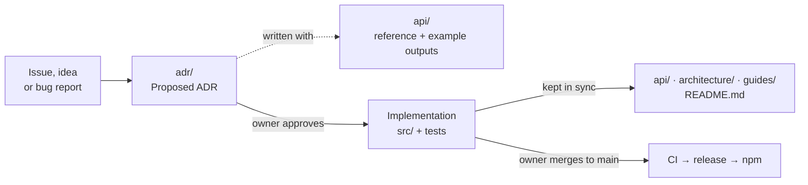

# Documentation

The map of what lives where. Each directory's `README.md` holds its own conventions. The rules
behind this layout are [ADR-0002](adr/ADR-0002-living-design-documentation.md).

**Using the package?** Start with [Getting started](guides/getting-started.md), then the
[API reference](api/README.md). **Contributing?** Read [`../AGENTS.md`](../AGENTS.md) first.

## Two kinds of document

| Kind | Directory | Changes how |
|---|---|---|
| **Decisions** | [`adr/`](adr/README.md) | **Immutable once approved.** A change of mind is a new ADR that supersedes the old one. |
| **Living documents** | everything else, and the root `README.md` | **Snapshots.** Describe the package as it stands right now, edited in place. What is no longer true is deleted, not annotated. |

How they relate:

## Directories

| Directory | Holds | Required when |
|---|---|---|
| [`adr/`](adr/README.md) | Architecture Decision Records and their index | Every feature and functional change ([ADR-0001](adr/ADR-0001-adr-driven-development-workflow.md)) |
| [`api/`](api/README.md) | Public API reference, one page per domain; [limitations](api/limitations.md) | Any change a consumer can observe ([ADR-0008](adr/ADR-0008-public-api-changes-ship-their-reference.md)) |
| [`architecture/`](architecture/README.md) | Module layering, build outputs, the `exports` map | A new domain, cross-domain import, or change to the build or published shape |
| [`guides/`](guides/README.md) | Getting started in each runtime, recipes, migration from v1 | A new way to use the package, or a breaking change |
| [`release/`](release/README.md) | Semver policy, CI and the release process | The versioning rules, CI or release process change |
| [`security/`](security/README.md) | Threat model, secrets inventory, release audit checklist | Always kept accurate; per-change analyses when warranted |
| [`_templates/`](_templates/) | A starting point for each document type | — |

## Conventions for every living document

- **Header**: `Status`, `Last updated`, `Related ADRs`.
- **Snapshot, not changelog**: no revision tables, no "previously", no strikethrough. The
  migration guide is the one document whose subject is a difference between versions.
- **Example outputs are real.** Every `// →` result is produced by running the built package.
  Run it again when the code changes.
- **Digits in examples are explicit.** Show both the input and the exact output string,
  including Devanagari digits (`"१२,३४,५६७"`), signs and spacing.
- **Diagrams are Mermaid** in fenced blocks. No binary or externally hosted images.
- **Links between documents are relative**, so they work on GitHub and locally.
- **Start from [`_templates/`](_templates/)**. If unsure whether a document is required, write it.
