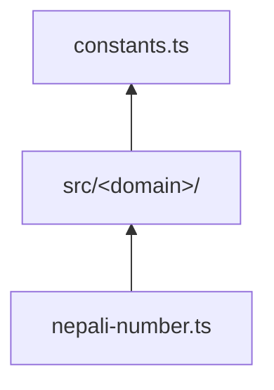

# Architecture — <area>

- **Status:** Draft
- **Last updated:** YYYY-MM-DD
- **Related ADRs:** ADR-NNNN

> Snapshot of the package as it stands today. Edit in place; never record what changed.

## Context

What this is, and the boundary between it and everything else.

## Components

| Component | Responsibility | Depends on |
|---|---|---|
| | | |

## Diagram

## Key decisions in force

Links to the ADRs that govern this, one line each on what they mandate.

## Constraints

Bundle size, runtime support, invariants (`AGENTS.md` §6) this must respect.
