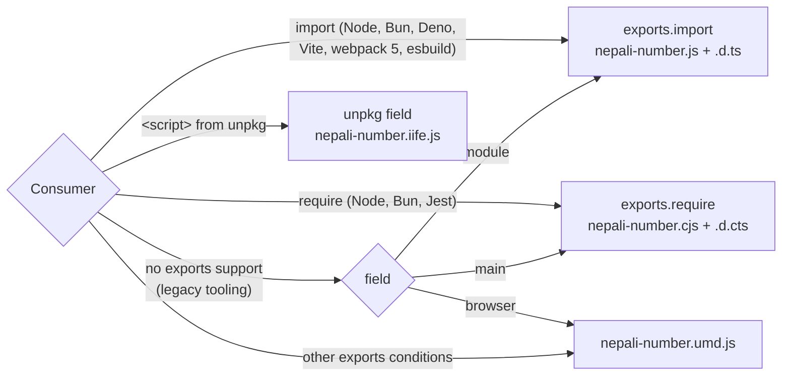

# Architecture — Build and distribution

- **Status:** Current
- **Last updated:** 2026-10-30
- **Related ADRs:** [ADR-0009](../adr/ADR-0009-package-invariants.md)

> Snapshot of the package as it stands today. Edit in place; never record what changed.

## Context

One TypeScript entry is built by **tsdown 0.15.12** (rolldown) into four JavaScript formats and
two declaration files. `package.json` points each kind of consumer at the right one.

## Build

`bun run build` runs `tsdown --clean --dts` with [`tsdown.config.ts`](../../tsdown.config.ts):

| Setting | Value | Why it matters |
|---|---|---|
| `entry` | `./src/nepali-number.ts` | Single public surface |
| `format` | `esm`, `cjs`, `iife`, `umd` | Bundlers, Node `require`, `<script>` with and without AMD/CommonJS |
| `outputOptions.name` | `nepaliNumber` | Global for IIFE and UMD |
| `dts` | `true` | Emits `.d.ts` (ESM) and `.d.cts` (CJS) |
| `minify` | `true` | All four formats are minified |
| `platform` | `node` | Output uses no Node APIs (§6.2), so it still runs in browsers |
| `shims` | `true` | Adds ESM/CJS interop shims only where the source needs them; this source needs none |
| `clean` | `true` | `dist/` is emptied before each build |

## Output

Sizes from the current build:

| File | Format | Size | gzip |
|---|---|---|---|
| `dist/nepali-number.js` | ESM | 9.23 kB | 2.85 kB |
| `dist/nepali-number.cjs` | CommonJS | 9.33 kB | 2.85 kB |
| `dist/nepali-number.umd.js` | UMD, global `nepaliNumber` | 9.42 kB | 2.92 kB |
| `dist/nepali-number.iife.js` | IIFE, global `nepaliNumber` | 9.24 kB | 2.83 kB |
| `dist/nepali-number.d.ts` | Types for ESM | 4.23 kB | |
| `dist/nepali-number.d.cts` | Types for CommonJS | 4.23 kB | |

The tarball (`npm pack --dry-run`) holds 9 files, 11.7 kB packed: the six above plus
`package.json`, `README.md` and `LICENSE`. `files: ["dist"]` keeps everything else out.

## Entry points

```json
{
  "type": "module",
  "main": "./dist/nepali-number.cjs",
  "module": "./dist/nepali-number.js",
  "browser": "./dist/nepali-number.umd.js",
  "unpkg": "./dist/nepali-number.iife.js",
  "types": "./dist/nepali-number.d.ts",
  "exports": {
    ".": {
      "import": { "types": "./dist/nepali-number.d.ts", "default": "./dist/nepali-number.js" },
      "require": { "types": "./dist/nepali-number.d.cts", "default": "./dist/nepali-number.cjs" },
      "default": "./dist/nepali-number.umd.js"
    },
    "./package.json": "./package.json"
  }
}
```

## How each consumer resolves



Only the root (`"."`) and `./package.json` are exported. Deep imports such as
`nepali-number/dist/nepali-number.js` are blocked by Node and modern bundlers; CDN URLs are not
affected because they read files directly.

Verified against the current build: ESM `import` and CJS `require` in Node 24, `import` in Bun
1.4.4, the ESM file in Deno 2.9, and the IIFE and UMD files exposing a global `nepaliNumber`
object.

## Type-checking

`bun run type-check` runs `tsc --noEmit` with [`tsconfig.json`](../../tsconfig.json):
`strict`, `noUncheckedIndexedAccess`, `noUnusedLocals`, `noUnusedParameters`,
`noPropertyAccessFromIndexSignature`, `noImplicitOverride`, `noFallthroughCasesInSwitch`,
`isolatedDeclarations`, `verbatimModuleSyntax`. `tsc` never emits; tsdown does.

## Key decisions in force

- [ADR-0009](../adr/ADR-0009-package-invariants.md) — zero runtime dependencies,
  environment-agnostic output, named exports only.

## Constraints

- Changing `exports`, the formats, the global name or the declaration layout is a major
  version (ADR-0008).
- No `prepare`, `preinstall`, `install` or `postinstall` scripts: nothing runs on a consumer's
  machine.
