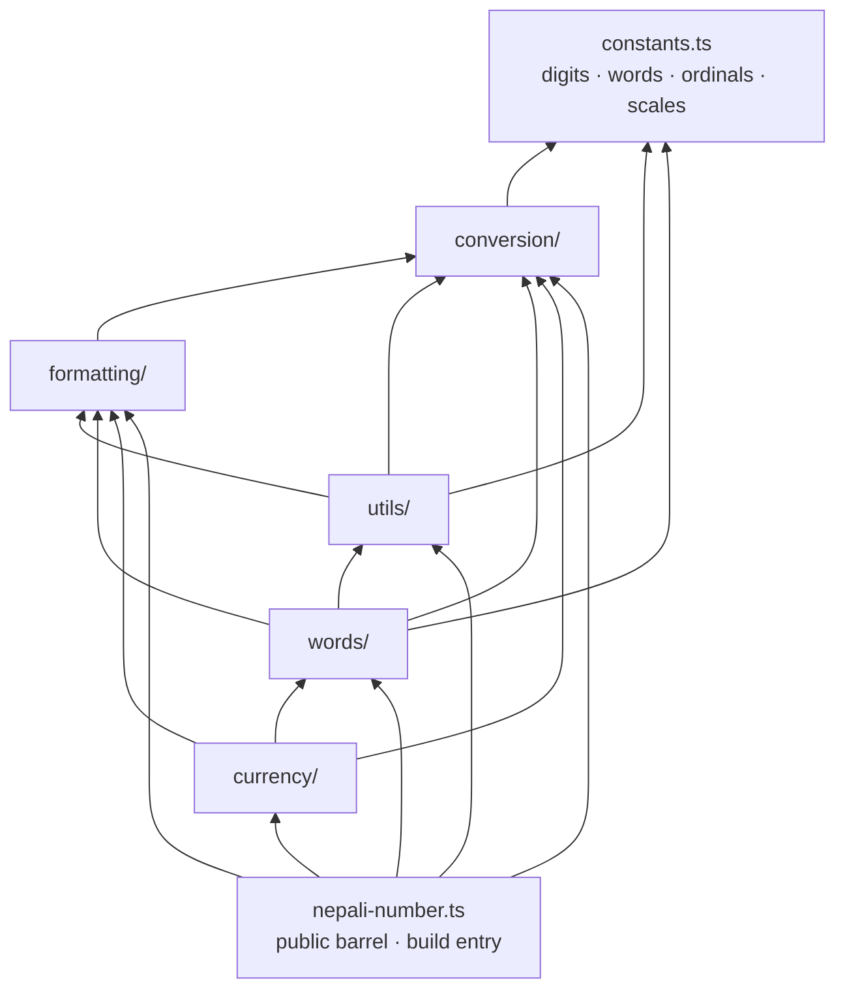

# Architecture — System

- **Status:** Current
- **Last updated:** 2026-10-30
- **Related ADRs:** [ADR-0009](../adr/ADR-0009-package-invariants.md)

> Snapshot of the package as it stands today. Edit in place; never record what changed.

## Context

`nepali-number` is a single-entry library of pure functions. There is no runtime state, no I/O
and no dependency. Everything a consumer can import is re-exported from one barrel,
`src/nepali-number.ts`, which is also the only build entry.

## Components

| Component | Responsibility | Depends on |
|---|---|---|
| `src/constants.ts` | All language data: `NEPALI_DIGITS`, `NEPALI_SCALES` (10² … 10¹⁹), `NEPALI_WORDS` (0–99), `NEPALI_ORDINALS_EXCEPTIONS` (0–4), `NEPALI_ORDINALS` (0–99), `ENGLISH_WORDS` | — |
| `src/conversion/` | Digit mapping and parsing: `toNepali`, `toEnglish`, `parseNepaliNumber`, `convert` | `constants` |
| `src/formatting/` | Grouping, precision, un-formatting: `formatNepaliNumber`, `addNepaliCommas`, `removeFormatting`; `FormatOptions` | `conversion` |
| `src/utils/` | Detection, validation, padding, rounding, `normalize`; `NumberSystem` | `constants`, `conversion`, `formatting` |
| `src/words/` | Cardinals, ordinals, abbreviations: `toNepaliWords`, `toEnglishWords`, `toNepaliOrdinal`, `toDecimalWord` | `constants`, `conversion`, `formatting`, `utils` |
| `src/currency/` | Rupee formatting and words: `toNepaliCurrency`, `toNepaliCurrencyWords`; `CurrencyOptions` | `conversion`, `formatting`, `words` |
| `src/nepali-number.ts` | Public barrel: `export *` from each domain's `index.ts` | every domain |

The language constants are **internal**: they are not re-exported from the barrel, so they can
change shape without a breaking change — only the strings the functions return are public.

## Diagram

Arrows point from a module to what it imports.



The order is a strict layering: `constants` → `conversion` → `formatting` → `utils` →
`words` → `currency`. A module imports only from layers to its left. There are no cycles.

## Inside a domain

```
src/<domain>/
├── <domain>.ts        # the functions — `export const name = (…): T => …`
├── <domain>.test.ts   # bun:test, imports from "."
├── types.ts           # option / result types (formatting, currency, utils)
└── index.ts           # export * from "./<domain>"
```

- Cross-domain imports use the `@/` alias and the domain root (`@/formatting`), never a file
  inside another domain.
- Domain-local imports use a relative path with the `.ts` extension (`./types.ts`), allowed by
  `allowImportingTsExtensions`.
- `index.ts` re-exports the functions only; `types.ts` is not re-exported today
  ([limitations](../api/limitations.md#option-types-are-not-exported)).

## How the functions compose

Most functions are thin compositions of a few primitives, which is why a behaviour of one
primitive shows up across the API:

| Primitive | Used by | Consequence |
|---|---|---|
| `parseNepaliNumber` | `toNepaliWords`, `toEnglishWords`, `toNepaliOrdinal`, `toDecimalWord`, `toNepaliCurrencyWords` | Commas are fine; garbage reads as `0` |
| `parseFloat(toEnglish(…))` inside `formatNepaliNumber` | `formatNepaliNumber`, `toNepaliCurrency`, `toDecimalWord` | String input stops at the first comma |
| `removeFormatting` | `roundNepali` | Formatted input and currency symbols are fine |
| `toFixed` | `formatNepaliNumber`, `roundNepali` | Binary floating-point rounding |

## Key decisions in force

- [ADR-0009](../adr/ADR-0009-package-invariants.md) — zero dependencies, environment-agnostic,
  pure, non-throwing for declared types; one-way layering.
- [ADR-0008](../adr/ADR-0008-public-api-changes-ship-their-reference.md) — the public surface
  is the barrel's exports and their output strings.

## Constraints

- `isolatedDeclarations`: every export has an explicit type, so `.d.ts` files are emitted per
  file without type inference across modules.
- No host globals — the same code runs in Node, Bun, Deno, browsers and workers.
- The minified build is about 9 kB per format (2.8 kB gzipped); see
  [build and distribution](build-and-distribution.md).
