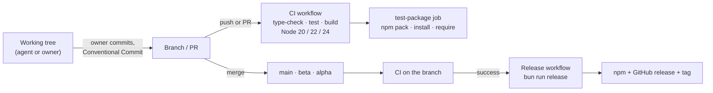

# Releasing

- **Status:** Current
- **Last updated:** 2026-10-30
- **Related ADRs:** [ADR-0005](../adr/ADR-0005-security-as-a-standing-practice.md), [ADR-0008](../adr/ADR-0008-public-api-changes-ship-their-reference.md)

> Snapshot of the process as it stands today. Edit in place; never record what changed.

## Flow

## CI — `.github/workflows/ci.yml`

Runs on every push and on pull requests (opened, synchronised, reopened). Newer runs on the
same ref cancel older ones.

| Job | Steps |
|---|---|
| `quality` (Node 20, 22, 24 on `ubuntu-latest`) | Bun `latest` · `bun install --frozen-lockfile` · `bun run type-check` · `bun run test` · Codecov upload (Node 24 only, `CODECOV_TOKEN`, fails the job on upload error) · `bun run build` |
| `test-package` (after `quality`) | Build · `npm pack` · install the tarball into a fresh project · `require("nepali-number")` and call `toNepali`, `toEnglish`, `formatNepaliNumber` |

## Release — `.github/workflows/release.yml`

Triggered by `workflow_run` when the **CI** workflow completes on `main`, `beta` or `alpha`.
One release per branch at a time; an in-progress release is never cancelled. Permissions:
`contents: write`. It checks out, sets up Node 20 and Bun, installs, and runs
**`bun run release`** with `GITHUB_TOKEN`.

## Current gaps

These are observed facts about the repository today. Fixing any of them is a CI/release
tooling change and needs an ADR (`AGENTS.md` §2).

1. **There is no `release` script.** `package.json` defines `build`, `dev`, `test`,
   `type-check`, `clean` and `clean:fresh`. `bun run release` fails, so the workflow cannot
   publish.
2. **The workflow runs on any completed CI run**, including failed ones. `workflow_run` with
   `types: [completed]` fires for every conclusion; the job has no
   `if: github.event.workflow_run.conclusion == 'success'` guard.
3. **It checks out the default ref, not the commit CI tested.** `actions/checkout` without
   `ref: ${{ github.event.workflow_run.head_sha }}` checks out the latest default-branch commit
   for a `workflow_run` event.
4. **No npm credential or provenance is configured.** There is no `NPM_TOKEN` in the workflow
   and no `id-token: write` permission for npm trusted publishing.
5. **npm and git disagree.** npm's `latest` is **1.0.3** (published 2019-08-25); no 2.x has
   been published. `package.json` on `main` says `2.0.0`. Tags `v2.0.1` and `v2.1.0` exist (the
   latter also on `origin`) on "chore: bump version" commits that are **not** on `main`.

## Manual release checklist

Until the workflow is complete, a release is the owner's manual step:

- [ ] `main` is green in CI.
- [ ] The release audit in [`../security/checklist.md`](../security/checklist.md) passes.
- [ ] `npm pack --dry-run` lists only `dist/*`, `package.json`, `README.md`, `LICENSE`.
- [ ] `README.md` and `docs/api/` match the build.
- [ ] Version bumped according to [`versioning.md`](versioning.md); tag and GitHub release
      notes written from the Conventional Commits since the last tag.
