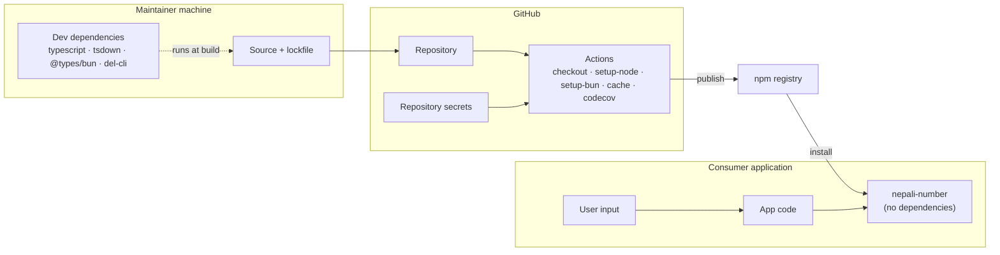

# Threat model

- **Status:** Current
- **Last updated:** 2026-10-30
- **Related ADRs:** [ADR-0005](../adr/ADR-0005-security-as-a-standing-practice.md), [ADR-0009](../adr/ADR-0009-package-invariants.md)

> Snapshot of the package as it stands today. Edit in place; never record what changed.

## What is worth protecting

The package holds no data. What it has is **reach**: its code runs, with the host's privileges,
inside every application, server, build and browser that installs it. The assets are:

- **Integrity of the published tarball** — consumers run whatever is on npm.
- **Availability of the host** — a function that hangs on input hangs the consumer's server.
- **Correctness of output** — amounts in words appear on invoices and cheques.

## Trust boundaries

## Threats and controls

| Threat | How | Control today | Gap |
|---|---|---|---|
| Malicious runtime dependency | A dependency (or its dependency) is compromised | **No runtime dependencies** (§6.1); a new one needs an ADR | — |
| Compromised dev dependency | A build tool runs code on maintainer or CI machines, or injects into `dist/` | Four dev dependencies, lockfile committed, `--frozen-lockfile` in CI | `@types/bun` is `latest`, and CI installs Bun `latest`; neither is pinned |
| Stolen publish credential | Someone publishes a malicious version | Publishing is not automated yet | No provenance, no trusted publishing ([releasing gaps](../release/releasing.md#current-gaps)) |
| Release from untested code | Release workflow runs after a failed CI, or on a different commit | — | Release has no success guard and checks out the default ref ([releasing gaps](../release/releasing.md#current-gaps)) |
| Compromised GitHub Action | A third-party action is altered | Actions pinned to major versions (`@v5`, `@v2`) | Not pinned to commit SHAs |
| Install-time execution | A lifecycle script runs on `npm install` | No `prepare` / `preinstall` / `install` / `postinstall` scripts | — |
| Tarball contains extra files | Secrets or tooling published by accident | `files: ["dist"]`; `npm pack --dry-run` in the release checklist | — |
| ReDoS | Crafted long input makes a regular expression backtrack | No pattern is exponential (see below) | **Two patterns are quadratic** and reachable with direct calls: `validateNepaliNumber` and `addNepaliCommas`. No long-input test yet |
| Unbounded work | Huge input makes words functions recurse deeply | Recursion depth follows the number's magnitude; `toNepaliWords(1.7e308)` finishes in under 2 ms | — |
| Wrong amount in words | A table error produces a wrong word on an invoice | Tests assert exact strings for each word table ([ADR-0007](../adr/ADR-0007-tests-are-part-of-every-change.md)) | Float rounding of paisa ([limitations](../api/limitations.md#floating-point-rounding)) |

### Regular expressions in `src/`

| Location | Pattern | Assessment |
|---|---|---|
| `conversion.ts` `toNepali` | `/[0-9]/g` | Linear |
| `conversion.ts` `parseNepaliNumber` | `/[, ]/g` | Linear |
| `formatting.ts` `formatNepaliNumber` | `/\.0+$/` | Linear (single quantifier, anchored) |
| `formatting.ts` `addNepaliCommas` | `/\B(?=(\d{2})+(?!\d))/g` | Lookahead re-scans the remaining digits at each position — quadratic in the digit count, bounded by how long a number string can be |
| `formatting.ts` `removeFormatting` | `/[,\s]/g`, `/[^\d.-]/g` | Linear |
| `utils.ts` `validateNepaliNumber` | `/^[०-९]*\.?[०-९]*$/` | **Quadratic** on a long digit run that fails at the end: the two `*` quantifiers split the run every possible way before giving up |
| `utils.ts` (others) | `/[0-9]/`, `/[०-९]/`, `/[,\s]/g`, `/\./g`, `/\s+/g`, `/,+/g`, `/\.+/g` | Linear |

### Measured on hostile input

Bun 1.4.4, Apple Silicon, from source:

| Call | 10 000 characters | 100 000 characters |
|---|---|---|
| `validateNepaliNumber("१".repeat(n) + "x")` | 37 ms | **5.5 s** |
| `addNepaliCommas("1".repeat(n))` | 61 ms | **6.4 s** |
| Every other export tried (`toNepali`, `toEnglish`, `parseNepaliNumber`, `normalize`, `removeFormatting`, `formatNepaliNumber`, `isMixedNumber`) | < 2 ms | < 4 ms |

`addNepaliCommas` is safe when reached through `formatNepaliNumber`, whose integer part is at
most ~22 digits (`toFixed` switches to exponent form at 10²¹). Called directly — and
`validateNepaliNumber` is typically called directly on a form field — a consumer that passes
unbounded user input can block its event loop for seconds. Until fixed (an ADR: the output
must not change), consumers should cap input length; a fix needs no new dependency.

## Residual risk

The release-path gaps above are accepted only until the release workflow is completed; the ADR
that completes it closes them. The two quadratic patterns are open findings awaiting an ADR.
